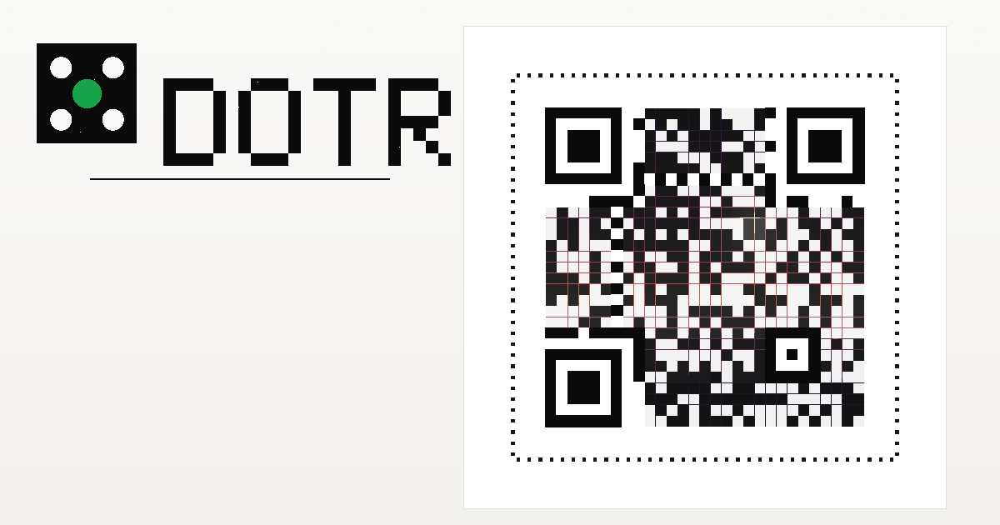

<div align="center">

# DOTRA

**Every dot tells a story.**

Turn any image into a genuinely scannable QR code where **the photograph is the
canvas**: a full-colour image fills the entire composition beneath a dense grid
of tiny black-and-white square modules, its detail visible in the hairline gaps
between modules — assembled live with a particle animation, then proven scannable
by decoding the <b>actual rendered pixels</b> before anything can be downloaded.

[](https://www.typescriptlang.org/)
[](https://react.dev/)
[](https://vitejs.dev/)
[](https://tailwindcss.com/)
[](https://github.com/cozmo/jsQR)
[](https://github.com/cixcex/DOTRA)
[](LICENSE)



*A real DOTRA output. The cover image itself was rendered by the engine and decoded
with jsQR at generation time — the same gate every export passes.*

</div>

---

## Table of contents

- [What it does](#what-it-does)
- [Highlights](#highlights)
- [The verification guarantee](#the-verification-guarantee)
- [Quick start](#quick-start)
- [How it works](#how-it-works)
- [The repair ladder](#the-repair-ladder)
- [Exports](#exports)
- [Testing](#testing)
- [Documentation](#documentation)
- [Project structure](#project-structure)
- [Deployment](#deployment)
- [Contributing](#contributing)
- [License](#license)

## What it does

DOTRA is a single-page studio that transforms photographs and artwork into QR codes
that **stay recognizable as the photograph and genuinely scan** — up to ~5,300
modules on a 73×73 matrix, a full-colour photograph filling the entire composition
beneath a dense, uniformly aligned grid of tiny black-and-white square modules, the
photograph's detail visible in the hairline gaps between them. It is not a sticker slapped on a code: the QR
matrix is generated genuinely from your link, structural modules stay pure black
and white, and the result is decoded by jsQR from the raster that would actually
be exported.

Everything runs in your browser tab. No servers, no uploads, no accounts, no
analytics on your content.

## Highlights

| | |
|---|---|
| **Genuine QR matrices** | Real ISO/IEC 18004 encoding; finder, timing, alignment, version and format patterns render as pure black/white — scanner-critical geometry is never decorated. |
| **Pixel-level verification** | jsQR decodes the *rendered raster*, not the internal matrix, and the payload is compared against your normalized URL. Downloads stay locked until a decode matches. |
| **Automatic repair** | A six-rung escalation ladder (tone separation → influence reduction → black & white → full-size square modules → ring off → EC level H) re-verifies at every step. The encoded URL never changes. |
| **Three quality modes** | Photo / Balanced / Scan — per-module luminance bands (Photo 10–118 / 230–250 …) keep the photograph's hue inside empirically calibrated, decoder-safe bounds. |
| **Photographic pipeline** | Saliency smart crop, percentile auto-contrast, CLAHE and an unsharp mask run client-side before a single dot is drawn. |
| **Square module grid** | The default look: a dense, uniformly aligned grid of tiny black-and-white square modules over the photograph — hairline gaps (0.14 × module pitch) let the photograph show *between* modules. |
| **Module styles** | Square (default), circle, rounded, soft glow, and **fragment** — true image crops inside each module, tone-clamped for scan safety. |
| **Photographic integration** | The photograph renders full-bleed beneath the module grid. Image influence, module contrast, black-and-white intensity and colour treatment blend each module toward pure black/white poles — scan-safe by construction, since the poles are the calibrated band extremes. |
| **Perforation border** | Optional decorative ring of black squares riding the white outer frame — engine-exact geometry (0.24 × module pitch, 4(N+q) squares), gated to a ≥ 3-module quiet zone. |
| **Five assembly animations** | Gather, flow, pulse, orbit, reveal — with the final animation frame pixel-identical to the verified static render. |
| **Three export formats** | PNG (1024/2048/4096 px), MP4 at 1080p30 (WebCodecs + mp4-muxer, explicit WebM fallback), GIF at 480 px. Each export re-verifies at its own resolution. |
| **24 sample artworks** | Procedurally generated, deterministic, license-free, bundled offline. |
| **Built-in QR tester** | Scan any QR with your camera or upload a photo and decode it locally. |

## The verification guarantee

> **No unverified QR ever leaves the app.**

1. The matrix is real; the render is rasterized; **jsQR decodes the pixels**.
2. The encoded URL is immutable during repair — only rendering parameters change.
3. Module dark/light values are never altered for aesthetics; tone mapping pins each
   module into its mode's calibrated luminance band (e.g. Photo: dark 10–118,
   light 230–250) with hue preserved, and the photographic blend only moves module
   colours toward the pure black/white poles — never across the decoder-safe gap.
4. PNG exports re-verify at 1024, 2048 and 4096 px; video at 1080 px; GIF at 480 px —
   anti-aliasing behaves differently at each size, so each is checked on its own pixels.
5. If the repair ladder is exhausted, the failure is reported honestly (including
   "decoded to a different link") and downloads stay disabled.

## Quick start

```bash
git clone https://github.com/cixcex/DOTRA.git
cd DOTRA
npm install
npm run dev          # local dev server
```

Production build and preview:

```bash
npm run build        # strict typecheck + vite build → dist/
npm run preview      # serve the production build
```

### Scripts

| Command | Purpose |
| --- | --- |
| `npm run dev` | Vite dev server |
| `npm run build` | `tsc --noEmit` + production build to `dist/` |
| `npm run preview` | Serve the production build locally |
| `npm run typecheck` | TypeScript check only |
| `npm run test:engine` | Node engine harness — **159 assertions, 0 failures** |
| `npm run gen:assets` | Regenerate favicons + OG cover (with a jsQR-verified photographic composite QR) |
| `npm run gen:samples` | Regenerate the 24 procedural sample artworks |

## How it works

```
URL ─▶ normalize & validate ─▶ encode QR matrix (qrcode-generator)
        ─▶ smart crop → CLAHE → unsharp → sample onto the N×N module grid
        ─▶ plan every module: luminance band → pole blend (influence / contrast / B&W)
        ─▶ render 5 layers: white frame → photo underlay → structural squares
           → black-and-white modules → perforation ring
        ─▶ jsQR decodes the ACTUAL rendered raster (Web Worker)
        ─▶ payload == your URL?  ──yes──▶ downloads unlocked
                                 └─no──▶ 6-rung repair ladder ─▶ re-render ─▶ re-verify
```

### The repair ladder

| # | Strategy | What changes |
|---|---|---|
| 1 | Wider band separation | dark cap 100 / light floor 238; image influence → 0.35 |
| 2 | + Black & white modules | influence → 0.2, strict grayscale tone |
| 3 | + Full-size square modules | size → 100%, spacing → 0, shape → square; influence → 0.1 |
| 4 | + Perforation ring off | decorative ring disabled; influence → 0.05, repair-3 bands |
| 5 | Maximum redundancy | as above + matrix re-encoded at EC level H; influence → 0 |

## Exports

| Format | Sizes / quality | Notes |
| --- | --- | --- |
| **PNG** | 1024 / 2048 / 4096 px | Opaque white background; each resolution verified independently |
| **MP4** | 1080 p · 30 fps · H.264 | WebCodecs + mp4-muxer; where MP4 is unsupported, an explicit note accompanies the WebM fallback |
| **GIF** | 480 px · 12 fps | Palette-quantized for stable file sizes |

## Testing

The Node harness (`npm run test:engine`) runs the **same DOM-free planning logic**
the browser uses and rasterizes with geometry-identical math, then decodes with jsQR:

- 180 rasterized composites decoded across 4 artworks × 3 modes × 5 shapes × 3
  shape-aware geometries — with real photographic underlays
- 48 URL × error-correction × version-bucket combinations with payload equality
- ISO 18004 function-module mask assertions (v2 = 282 protected modules, hand-computed)
- Photographic-fidelity metrics: per-band luma r = 1.000/0.996, mean Δhue 1.7°,
  chroma retention 0.66, shuffled-control spatial checks
- Six photo categories (portrait, landscape, animal, dark, bright, multicolor)
  × three modes at v14 — decode + fidelity, 18/18
- Composite acceptance: 3 URLs × 6 photo categories × 2 rasters (1024/512 px)
  decode with exact URL match — 36/36; module style × influence 15/15;
  influence × colour treatment × ring 12/12
- Hostile circle-extreme composites fail at defaults and are rescued by the
  ladder (full-size square modules); dark photography proves robust at defaults
- Pixel-level composite evidence: dropped light modules show the photograph,
  hairline gaps show the photograph, dark module centres stay dark, perforation
  squares are black with white clearance
- Animation timeline math + real scene builder; portrait/landscape/square sources
  via center crop; final-frame determinism (export == preview pixels)

**Result: 159 passed, 0 failed.** Full detail in [docs/testing-report.md](docs/testing-report.md).

## Documentation

- [docs/architecture.md](docs/architecture.md) — module map, pipeline data flow, geometry, workers, Node testability design
- [docs/qr-engine.md](docs/qr-engine.md) — matrix generation, the function-module mask, tone mapping, the jsQR calibration findings, verification contract
- [docs/testing-report.md](docs/testing-report.md) — harness coverage, tone-calibration experiments, browser-side gate, manual QA checklist

## Project structure

```
├── index.html
├── public/                  # favicons + OG cover (a real verified DOTRA output)
├── scripts/                 # Node tooling: engine tests, asset/sample generators
│   ├── test-engine.ts       #   159-assertion harness (Node, no DOM)
│   ├── generate-assets.ts   #   favicons + OG cover
│   ├── generate-samples.mjs #   24 procedural sample artworks
│   ├── pngkit.mjs           #   dependency-free PNG codec for Node
│   └── bundle-run.mjs       #   esbuild loader for the TS tooling
├── src/
│   ├── engine/              # QR, image, dots, particles, verification, exporters
│   ├── workers/             # jsQR decode worker (transferable buffers)
│   ├── hooks/               # useQRGenerator (pipeline + repair), useParticleAnimation
│   ├── components/          # Hero, Studio, panels, exporters, Test QR modal…
│   ├── lib/                 # constants, sample registry
│   ├── utils/               # colour, contrast, URL, image helpers
│   └── assets/samples/      # 24 bundled sample artworks
└── docs/                    # architecture, QR engine, testing report
```

## Deployment

DOTRA is a static site with zero environment variables and zero server-side
requirements. Deploy the repository to any static host — Vercel auto-detects the
Vite build. A separately packaged bundle (`DOTRA-Vercel-Ready.zip`) adds an explicit
`vercel.json` SPA rewrite and step-by-step deployment docs.

## Contributing

See [CONTRIBUTING.md](CONTRIBUTING.md) for the dev setup, the commands that matter,
and the non-negotiables (verification gate, immutable payload, calibrated tones)
that every change must preserve.

## License

[MIT](LICENSE)

## Credits

Built with [jsQR](https://github.com/cozmo/jsQR) (verification),
[qrcode-generator](https://github.com/kazuhikoarase/qrcode-generator) (matrix
encoding), [gifenc](https://github.com/antimatter15/gifenc) (GIF),
[mp4-muxer](https://github.com/videosoft/mp4-muxer) (MP4), React, Vite and
Tailwind CSS. The 24 sample artworks are procedurally generated and license-free.
